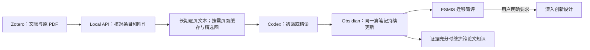

# FSMIS Research Workflow

[](https://github.com/mayByt/fsmis-research-workflow/actions/workflows/tests.yml)
[](LICENSE)

面向医学图像分割研究者的 **Zotero → Codex → Obsidian** 论文阅读工作流：从文献管理、逐页原文归档，到网络结构、公式、实验协议与消融分析，最后形成可追溯、可持续更新的个人研究笔记。

以少样本医学图像分割（Few-Shot Medical Image Segmentation，FSMIS）为研究核心，同时支持常规医学分割、通用计算机视觉、综述和 Benchmark。阅读其他领域的论文时，先忠实理解它原本解决的问题，再简评其对 FSMIS 的启发。

**默认行为：每篇论文给出简短 FSMIS 迁移判断；只有你明确要求时，才深入设计创新方案。**

版本：0.1.0 · Python 3.11+（CI 覆盖 3.11/3.12）· Zotero 本机个人库 · 无需 Zotero Web API Key。

## 导航

- [设计思路与职责分工](#设计思路与职责分工)
- [安装与第一篇论文入库](#安装与第一篇论文入库)
- [全文、页面缓存与精选图](#全文页面缓存与精选图)
- [日常使用示例](#日常使用示例)
- [如何保护个人思考](#如何保护个人思考)
- [目录、配置与 Skills](#目录配置与-skills)
- [授权诊断：Operation not permitted](#codex-中出现-operation-not-permitted)
- [常见问题](#常见问题)
- [验证、限制与开源范围](#验证限制与开源范围)

## 设计思路与职责分工

### 从“存论文”到“积累可查证的理解”

一篇论文常常先被快速浏览，再在需要时深入阅读。工作流让同一篇论文沿用同一份笔记：初筛后保留阅读定位，精读时继续补充模块、公式和实验分析，后续检索可以回到原文核验。

| 组件 | 主要职责 | 你能得到什么 |
|---|---|---|
| Zotero | 管理书目信息、原 PDF 与批注 | 稳定的父条目 Key、PDF 附件身份和原文入口 |
| Python 工具 | 读取 Local API、定位附件、提取文本、渲染页面、受保护地写入 | 带物理页码和源文件散列的全文，以及可验证的双向链接 |
| Codex + Skills | 按阅读目的理解原文、解释图表/公式、评价实验 | 中文分析笔记、证据定位与明确标注的未决问题 |
| Obsidian | 查看、编辑、链接和长期检索 Markdown | 一篇一份笔记、个人思考与跨论文知识 |



**脚本入库与 AI 精读是两个阶段。** `ingest` 创建原文归档和笔记骨架，分析由你发起的 Codex 会话完成。新论文加入 Zotero 后，不会自动启动后台阅读。

本包不内置 OpenAI API 调用，也不需要在配置中填写 OpenAI API Key；Codex 本身的登录、权限、额度与费用取决于你所使用的服务。原文保存在本机，但交给模型阅读的内容会进入相应会话；“本地归档”不代表模型推理必然离线。

### 四个组织原则

1. **以稳定身份定位论文。** 父条目 `zotero_key` 标识论文，`pdf_key` 标识附件，题名仅用于展示。重复入库按 Key 复用已有文件。
2. **原文、分析和假设分层。** 全文保留提取结果；笔记区分作者报告、读者解释与未验证假设；跨论文结论需要核对来源。
3. **通用主模板 + 可叠加领域模块。** 研究问题、方法、公式、实验和局限使用共同结构，专业问题按原论文选择模块。
4. **阅读深度按需增加。** 默认迁移简评不创建 Idea 文档；只有明确提出创新设计请求，才生成研究假设和实验方案。

### 不同类型的论文，重点不同

| 原论文类型 | 专项解析重点 | 避免的误读 |
|---|---|---|
| FSMIS | N-way K-shot、Support/Query、Base/Novel、原型/匹配、采样与 fold | 将一个 shot 默认当成一个病例；忽略患者重叠或标注预算 |
| 非少样本医学图像分割 | 模态、2D/3D、预处理、编解码结构、边界与泛化评测 | 为普通监督分割虚构 Support/Query 设置 |
| 通用 CV / 表征学习 | 原始任务、特征交互、预训练、目标函数、性能与成本 | 将 Top-1、mAP 等原任务指标强行换成 Dice |
| 综述 / Benchmark | 覆盖范围、Taxonomy、路线比较、统一评测与开放问题 | 把综述中介绍的方法当作作者原创网络 |

一篇 FSMIS 论文可以同时使用医学分割模块；一篇医学分割综述可以同时使用综述和医学模块。内容未报告时应明确写“未报告”，不从领域惯例补齐。

## 安装与第一篇论文入库

建议先在**新建、独立的 Vault** 中跑通一篇论文，再接入已有文献库。以下操作由你手动执行一次，后续阅读主要使用自然语言。

### 0. 准备软件与两个目录

| 前置条件 | 检查方式 |
|---|---|
| Git | 终端运行 `git --version` |
| Python 3.11+ | macOS/Linux：`python3 --version`；Windows：`py -3.12 --version`（按已安装版本调整） |
| Zotero 桌面端 | 能启动；个人库中有一篇父文献及其本地 PDF 子附件 |
| Obsidian | 能打开本机文件夹作为 Vault |
| Codex | 已完成其自身的安装与登录，能在指定本机目录中读取文件并运行命令 |

软件入口：[Python](https://www.python.org/downloads/) · [Git](https://git-scm.com/downloads) · [Zotero](https://www.zotero.org/download/) · [Obsidian](https://obsidian.md/download) · [Codex](https://developers.openai.com/codex/)。

本项目没有 GPU 或 CUDA 要求，当前任务是阅读与归档。无需为运行本包先安装 PyTorch、MinerU、Dataview 或 Zotero 第三方插件。

请区分这两个目录：

```text
Research/
├── fsmis-research-workflow/   # 代码仓库：执行安装/维护命令，保留 .venv
└── ResearchVault/            # 你的研究内容：在 Obsidian 和 Codex 中打开
```

两个目录可以放在其他位置；后面所有命令中的 Vault 路径必须指向**同一个文件夹**。不要把代码仓库当作论文 Vault，也不要删除安装后仍被引用的代码仓库。

### 1. 克隆仓库并安装依赖

**macOS / Linux**：打开终端，进入你想保存代码的目录，然后执行：

```sh
git clone https://github.com/mayByt/fsmis-research-workflow.git
cd fsmis-research-workflow
python3 -m venv .venv
source .venv/bin/activate
python -m pip install -r requirements.txt
```

如果 `python3` 低于 3.11，先安装受支持的版本，再使用相应解释器创建 `.venv`，例如 `python3.12 -m venv .venv`。

**Windows PowerShell**：

```powershell
git clone https://github.com/mayByt/fsmis-research-workflow.git
cd fsmis-research-workflow
py -3.12 -m venv .venv
.\.venv\Scripts\Activate.ps1
python -m pip install -r requirements.txt
```

这里用 Python 3.12 举例；已安装 3.11 时可改为 `py -3.11`。如果 PowerShell 拒绝运行激活脚本，可直接使用虚拟环境解释器：

```powershell
.\.venv\Scripts\python.exe -m pip install -r requirements.txt
```

之后将示例中的 `python` 替换为 `.\.venv\Scripts\python.exe`，无需修改系统执行策略。macOS/Linux 也可用 `.venv/bin/python`，避免终端激活状态不一致。

**预期结果**：依赖安装成功；之后所有工具都使用该虚拟环境的 Python。重新打开终端时，先进入代码目录并重新激活虚拟环境。

### 2. 初始化 Vault，并在 Obsidian 打开

仍在**代码仓库根目录**执行。macOS/Linux 示例：

```sh
python tools/install.py --vault "$HOME/Research/ResearchVault"
```

Windows PowerShell 示例：

```powershell
python tools/install.py --vault "$env:USERPROFILE/Research/ResearchVault"
```

使用你自己的位置时，请填完整路径；路径中有空格或中文时保留引号。后文用 `"/absolute/path/to/ResearchVault"` 统一表示这个实际路径，它是占位符。

安装会创建目录，复制通用模板、四类模块和七个 Skills，生成 `WORKFLOW.md` 和首页，并在已有 `AGENTS.md` 中增加入口。它不会导入示例论文，也不会批量修改已有论文笔记。

打开 Obsidian，选择“打开文件夹作为仓库 / Open folder as vault”，选择刚才的 **ResearchVault**，查看 `00dashboard/科研阅读首页.md`。

**预期结果**：Vault 中存在 `AGENTS.md`、`WORKFLOW.md`、`模板/`、`02vault/`、`03fulltext/`。`.agents/skills/` 是隐藏目录，文件浏览器中不显示不代表没有安装。

若安装发现不同内容的已有文件，会停止并列出冲突。先审查差异；确需更新模板和 Skills 时才使用 `--update-managed`。该选项会备份并替换工具管理的文件，详见后面的升级说明。

### 3. 开启 Zotero Local API，找到真实 Key

在 Zotero 设置的 **Advanced / 高级** 中，允许本机其他应用与 Zotero 通信。保持 Zotero 开启，然后在代码仓库终端执行：

```sh
python tools/workflow.py doctor
python tools/workflow.py list
python tools/workflow.py list --query "论文题名中的关键词"
```

返回列表大致如下；**这是合成示意，不是可直接使用的真实条目**：

```json
[
  {
    "key": "ABCD1234",
    "title": "Example medical segmentation paper",
    "type": "journalArticle"
  }
]
```

复制你自己结果中的**父文献 Key**，检查附件：

```sh
python tools/workflow.py inspect ABCD1234
```

**预期结果**：显示父条目、PDF 附件及其 `pdf_path`、集合和批注信息。PDF 需要作为父文献下的真实子附件，且已下载到本机；网页链接或云端占位记录不足以完成归档。

`ABCD1234`、`EFGH5678` 在本文均为示例 Key，运行前必须替换。多 PDF 附件时显式选定：

```sh
python tools/workflow.py inspect ABCD1234 --pdf-key EFGH5678
```

`doctor`、`list`、`inspect` 不需要 Vault 参数。当前只支持本机个人库 `/api/users/0`，不支持 Zotero 群组库。

### 4. 先跑通脚本入库和检查

将下面的 Vault 路径与 Key 替换成你的实际值：

```sh
python tools/workflow.py --vault "/absolute/path/to/ResearchVault" ingest ABCD1234
python tools/workflow.py --vault "/absolute/path/to/ResearchVault" validate
python tools/refresh_index.py --vault "/absolute/path/to/ResearchVault"
```

存在多附件时，第一条命令末尾增加 `--pdf-key EFGH5678`。注意：`workflow.py` 的全局参数 `--vault` 放在 `ingest`、`validate`、`update` 等子命令**之前**。

| 返回状态 | 意义与下一步 |
|---|---|
| `INGESTED_NOT_ANALYZED` | 全文和笔记骨架已建立，接下来让 Codex 阅读 |
| `REUSED` | 已有身份、源文件和归档检查通过，沿用原文件 |
| `PASS`（validate） | 文件、身份、页数、图像及链接等检查通过；不代表科研结论已核实 |
| `STOPPED` / `FAIL` | 查看 error，解决缺附件、低文本页、身份或路径问题后再继续 |

在 Obsidian 中检查：

- `02vault/<collection>/`：论文笔记，初始 `reading_status: inbox`。
- `03fulltext/<collection>/<zotero_key>.md`：逐页文本与物理页号。
- 同目录 `images/<zotero_key>/`：仅存放精选保留的页面；首次入库可没有此目录。
- `_staging/page-cache/`：按需渲染的临时页面，不写入笔记的长期链接。
- 笔记中的全文链接、全文中的笔记链接，以及 Zotero 原 PDF 入口可打开。
- `02vault/_index/文献索引.md`：刷新后生成的索引。

再次运行同一条 `ingest`，应返回 `REUSED`；这可确认基本去重流程正常。

### 全文、页面缓存与精选图

全文 Markdown 是便于检索和追溯的长期文本档案；原始排版仍以 Zotero PDF 为准。新入库不再为所有页面生成 PNG，避免文献库增长时累积低使用率图片。

```sh
# 仅渲染需要核验的物理 PDF 页，输出缓存绝对路径
python tools/workflow.py --vault "/absolute/path/to/ResearchVault" render ABCD1234 --pages 3,5-7
# 重要图表所在页面精选保留，全文自动建立稳定图片链接
python tools/workflow.py --vault "/absolute/path/to/ResearchVault" render ABCD1234 --pages 3 --keep
# 预览超过 30 天未使用的缓存；加 --apply 才实际删除
python tools/workflow.py --vault "/absolute/path/to/ResearchVault" cache-prune --days 30
python tools/workflow.py --vault "/absolute/path/to/ResearchVault" cache-prune --days 30 --apply
```

缓存按 `zotero_key/source_sha256/物理页号` 存在 `_staging/page-cache/`；每次使用更新时间。精选 PNG 保存在原全文同目录 `images/<key>/page-XXX.png`，`retained_pages` 登记长期保留页。**嵌入笔记前先用 `--keep`，不要链接临时缓存。**源 PDF 的附件身份、内容散列或页数变化时停止渲染，防止复用错误页面。没有缓存不影响全文校验，精选图和实际图片链接缺失仍会报错。工具输出的是整页，尚不自动裁剪 Figure。

已有全页 PNG 的 Vault 可先预览迁移：

```sh
python tools/workflow.py --vault "/absolute/path/to/ResearchVault" migrate-images
python tools/workflow.py --vault "/absolute/path/to/ResearchVault" migrate-images --apply --backup-dir "/absolute/path/to/backups"
python tools/workflow.py --vault "/absolute/path/to/ResearchVault" validate
```

迁移前备份原始全文和 PNG；扫描 Vault 内 Markdown 的 Wiki、Markdown 和 HTML 图片链接，所有已引用页面保持原位置，其余生成页面转入缓存，并移除对应的全文自动嵌入。逐页文本、页标题、Zotero 页面链接和论文笔记保持原样。失败会回滚，重复运行不会重复迁移。迁移时暂停外部编辑；迁移后可预览 `cache-prune --days 0`，确认后加 `--apply` 立即清理未引用缓存。备份 ZIP 不自动删除；未指定备份目录时存于 Vault 的 `_staging/backups/`。不解析任意插件的私有引用格式，如有仅存于插件数据中的引用，先在 Markdown 中建立链接再迁移。

### 5. 在 Vault 中启动 Codex，完成第一次阅读

在 Codex 桌面端选择/打开 **ResearchVault** 作为当前本机项目目录；使用 Codex CLI 时，可先在终端进入该 Vault，再启动已安装的 `codex`。

先给一次初始化指令：

> 读取当前 Vault 的 AGENTS.md 和 WORKFLOW.md，确认七个工作流 Skills 及其工具路径可访问。后续使用已安装依赖的虚拟环境运行工具。

再发送阅读请求：

> 阅读 Zotero 中《你的论文题名》（父 Key：你的真实 Key）。先初筛核心贡献、主要方法、实验证据和局限，按模板更新 Obsidian，并保留简短 FSMIS 迁移价值判断。

Skill 没有自动显示时，重新打开该 Vault 的会话，或直接让 Codex 读取 `.agents/skills/research-vault-ingest-orchestrator/SKILL.md`。工具目录与 Vault 不同时，Codex 可能需要你允许访问相应本机路径；按当前环境的权限提示处理。

**首次搭建验收**：Zotero 能列出条目 → PDF 本机可读 → 首次入库成功 → 重复入库复用 → validate 通过 → Codex 将分析写回同一笔记 → Obsidian 能查看结果。只有完成分析后，笔记才应从 inbox 升级为 skimmed 或 deep_read。

## 日常使用示例

以下示例以自然语言发给 **Vault 中的 Codex 会话**，不需要逐次记住脚本参数。题名、Key、图号和表号都应根据实际论文调整。

### 场景 A：初筛一篇 FSMIS 论文

> 阅读 Zotero 中《论文题名》，父 Key 为 ABCD1234。说明它解决什么问题、主要贡献、Support/Query 设置和关键实验，判断是否值得精读，并更新 Obsidian。FSMIS 迁移价值只给简评。

预期：形成研究定位、方法轮廓、关键结果和待核验问题；`reading_status: skimmed`、`reading_level: skim`、`transfer_mode: brief`。尚未精读的章节应标为待精读，而不是填满未经核验的内容。

### 场景 B：完整精读，准备讲清方法

> 精读 ABCD1234，重点解释 Figure 2。按模块说明动机、输入输出和张量尺寸、计算步骤及公式对应关系；分析关键损失和训练/推理区别。逐表讲清消融支持什么、不支持什么，给物理 PDF 页码，并更新原笔记。迁移部分保持简评。

预期：原笔记升级为 `deep_read` / `deep`；公式和数字可回到具体页、图或表；保留未报告的协议细节与歧义。深读完成不表示已经训练复现。

医学分割中尤其值得核对：一个 shot 是切片、病例还是体数据；患者级划分；Base/Novel 和 fold；预训练是否一致；Support 选择；Dice 的汇总方式；HD95 的定义与单位；多次采样和随机种子是否报告。没有报告的指标不能据边界损失或可视化推断出来。

### 场景 C：读一篇常规医学分割或通用 CV 论文

> 阅读这篇 3D 医学分割论文，重点解释体数据处理、网络结构、训练目标、Dice/HD95 和泛化评测。按它实际采用的任务设置组织内容，最后简评对 FSMIS 的启发。

或：

> 阅读这篇自监督表征学习论文，保留它原来的任务、训练数据和评测指标。解释表示学习机制，再判断对少样本医学分割是否存在合理迁移切入点。

预期：选择相应领域模块，不虚构 Few-shot 设置。综述则重点产出 Taxonomy、路线比较和待精读的原始工作，而非强造原创网络和损失。

### 场景 D：跨论文比较与检索

> 检索当前 Vault 中与原型建模和边界误分有关的论文。比较机制、标注预算、数据划分和证据强弱；协议不一致时说明差异。关键结论请回到原文核验，并链接已有笔记。

预期：先在分析笔记中定位候选，再查对应全文和 PDF；区分当前库的证据与尚未阅读的引用。该请求默认不扩大为互联网文献调研。

### 场景 E：明确要求深入创新设计

> 基于 ABCD1234 的方法，深入设计两种适用于 FSMIS 的可检验改进方案，写清假设、机制对应、数学表达、最小对照和消融、失败条件，并保存到 ideas。

这是明确的深入触发：可以在 `04projects/ideas/` 生成独立方案。默认简评仅使用 `high / potential / low / uncertain` 四档，并注明依据与障碍；不生成没有依据的精确创新分数。

### 场景 F：将精读结果用于组会

> 根据 ABCD1234 的精读笔记与原文，整理 10 分钟组会提纲，给出 Figure 2 的讲解顺序、三项重点消融和可能被追问的问题。若需要保存，请放入 05meetings。

本包可组织提纲和讲稿素材；生成 PPTX 等成品需要会话中另有相应工具。本包不内置演示文稿生成器。

## 如何保护个人思考

论文笔记的第 **00–09 节**位于自动分析区域，第 **10 节“我的思考与组会材料”**位于人工区域。日常请把自己的评价、不同意见、批注和实验想法写在第 10 节，保留四个区域标记及其顺序。

| 内容 | 更新方式 |
|---|---|
| 原文分析、模块、公式、实验与简评 | 明确请求初筛/精读时，Codex 可更新自动区 |
| 个人思考与对 AI 的反馈 | 保留在第 10 节；更新工具保持该区内容 |
| Zotero 身份和路径 | update 不允许修改，变更需另行审查 |
| 独立 Idea 文档 | 明确要求深入创新时才创建/更新 |

把个人意见写进自动区后，后续精读可能替换它。已有笔记缺少保护标记时，工具会停止，应先审查迁移。

更新前的完整笔记保存在 `_staging/backups/`。需要恢复时，先保留当前文件，对比备份，再恢复或合并需要的内容；模板变化不会自动重解析 PDF，也不会自动重写历史笔记。

如果你需要手动调用写入接口，先准备 UTF-8 的 `analysis.md`（只含第 00–09 节，无保护注释），以及可选的分析字段 `metadata.json`：

```sh
python tools/workflow.py --vault "/absolute/path/to/ResearchVault" update ABCD1234 --body "/path/to/analysis.md" --metadata "/path/to/metadata.json"
```

允许字段和取值见 [Schema](docs/SCHEMA.md)。该命令更新分析区并备份原笔记，不会依据新题名创建另一份文件。

## 目录、配置与 Skills

### Vault 的内容分层

```text
ResearchVault/
├── AGENTS.md                  # Codex 工作入口
├── WORKFLOW.md                # 安装时写入实际工具根目录和解释器位置
├── .agents/skills/            # 七个 Skills
├── 00dashboard/               # 首页
├── 01knowledge/               # 有来源与条件的跨论文知识
├── 02vault/
│   ├── _index/文献索引.md
│   └── <collection>/<title>--<zotero_key>.md
├── 03fulltext/
│   └── <collection>/
│       ├── <zotero_key>.md
│       └── images/<zotero_key>/page-003.png # 按需精选保留
├── 04projects/ideas/          # 明确要求后生成创新方案
├── 05meetings/                # 按需保存组会素材
├── 06assets/
├── 模板/
│   ├── 论文精读模板.md
│   └── 领域模块/
└── _staging/                  # 元数据、页面缓存、锁、更新备份与安装记录
```

稳定身份和双向路径字段为 `type: literature-note`、`zotero_key`、`pdf_key`、`note_path`、`fulltext_path`。Vault 内链接使用相对路径。完整字段见 [Schema](docs/SCHEMA.md)，不是所有 Knowledge 页都使用文献笔记 Schema。

### 可选配置：少写重复路径

在代码仓库复制 `config.example.toml` 为 **config.toml**，填入实际路径；macOS/Linux 可用 `cp`，PowerShell 可用 `Copy-Item`。例如代码仓库与 Vault 是前述并列关系时：

```toml
[paths]
vault_root = "../ResearchVault"
# 如需自定义 Zotero 数据目录，再增加 zotero_data_dir = "实际路径"

[zotero]
api_url = "http://localhost:23119/api/users/0"
```

配置中的相对路径基于**配置文件目录**。使用默认数据目录时，删除 config.example.toml 中空的 `zotero_data_dir` 一行，未配置该项时工具回退到 `~/Zotero`；自定义时填写 Zotero 实际数据目录，而不是应用程序安装目录。当前版本的空字符串配置不等同于省略该项。

设置好后可简写为：

```sh
python tools/workflow.py ingest ABCD1234
python tools/workflow.py validate
python tools/refresh_index.py
```

| 配置项 | 可用环境变量 |
|---|---|
| 配置文件位置 | `RESEARCH_WORKFLOW_CONFIG` |
| Vault 路径 | `RESEARCHVAULT_ROOT` |
| Zotero 数据目录 | `ZOTERO_DATA_DIR` |
| 本机 API URL | `ZOTERO_LOCAL_API_URL` |

显式 `--vault` 优先于环境变量和配置；环境变量覆盖对应配置项。API 限定为本机 HTTP 个人库路径。`config.toml` 已被 Git 忽略，不应公开包含个人路径的配置。

### 七个 Skills 如何配合

| Skill | 何时使用 |
|---|---|
| `research-vault-ingest-orchestrator` | 指定论文的入库、初筛或完整精读总流程 |
| `zotero-data-fetcher` | 核对父条目、附件、批注与本机 PDF |
| `zotero-fulltext-archiver` | 长期全文、按需页面缓存、精选图与迁移 |
| `zotero-analytical-writer` | 按主模板、领域模块写作和更新 |
| `research-vault-literature-retrieval` | 从已有笔记检索，再追踪全文核验 |
| `research-vault-knowledge-maintainer` | 有证据时维护跨论文主题、关系和争议 |
| `fsmis-idea-lab` | 用户明确要求深入设计创新方案 |

Skills 是给 agent 的指令与资源；把文件复制到目录并不等于已经完成 AI 阅读。没有足够跨论文证据时，知识维护可以返回 `NO_KNOWLEDGE_CHANGE`，不必为每篇论文创建知识综合页。现有 Knowledge Schema、模板和人工内容应继续遵循原有约定。

### 升级仓库或移动目录

先保存本地修改、备份 Vault，并查看待更新内容，再在代码目录运行：

```sh
git pull --ff-only
python -m pip install -r requirements.txt
python tools/install.py --vault "/absolute/path/to/ResearchVault"
```

若发现管理文件冲突，审查后再执行：

```sh
python tools/install.py --vault "/absolute/path/to/ResearchVault" --update-managed
```

该选项会替换安装器管理的模板、Skills、`WORKFLOW.md` 和首页；旧文件备份到 `_staging/install-backups/`。个人改过模板或 Skill 时，先对比再合并。已有论文笔记不会因此自动升级。

移动代码目录或换 Python 虚拟环境后也需要重新安装并审查差异，因为已安装的指令记录了工具根目录和解释器位置。

## 常见问题

### Codex 中出现 Operation not permitted

先运行只读检查：

```sh
python tools/workflow.py doctor
```

- `READY`：已连通本机个人库 API；不表示完成论文分析。
- `LOCAL_API_PERMISSION_DENIED`：连接在收到 HTTP 响应前被宿主/系统拒绝。已安装的 Skills 会指导 Codex 对同一命令请求正常权限审批并重试一次；在同一沙箱中重复命令不会改变权限。
- `ZOTERO_API_FORBIDDEN`：收到 HTTP 403，检查 Zotero 的本机通信设置。
- `ZOTERO_API_CONNECTION_REFUSED`：检查 Zotero 是否已运行，以及 API 端口是否正确。
- `ZOTERO_API_TIMEOUT`：检查服务响应及网络策略；超时本身不能证明权限被拒绝。

若当前会话禁止审批，Codex 应报告这个限制。CLI 可通过 `/permissions` 查看模式，桌面端可查看输入框下方的权限控制；选择是否允许正常审批由用户决定。本包不会改写全局配置，也不会要求关闭沙箱。普通系统终端中的同一条 doctor 命令可用于对照诊断，但终端成功不会自动授予 Codex 会话权限。参见 [OpenAI 官方权限说明](https://learn.chatgpt.com/docs/sandboxing)。

更新已有安装时，需要将改过的 Skills 更新到 Vault；审查后使用本页的 `install.py --update-managed` 流程。旧会话可以显式重读 AGENTS.md 和对应 SKILL.md。

| 现象 | 检查与处理 |
|---|---|
| `ModuleNotFoundError` | 当前 Python 可能不是 `.venv` 的解释器；用虚拟环境 Python 重新安装 requirements，再运行工具 |
| Local API 报错 | 先运行 doctor，按错误码区分权限拒绝、HTTP 403、端口拒绝和超时，见上文 |
| `list` 返回 `[]` | 当前个人库或关键词没有匹配；先尝试不带 query 的 list，确认文献位于个人库 |
| PDF 数量不是 1 | 确认父条目下有实际 PDF；多个附件时用 inspect/ingest 的 `--pdf-key` 明确选择 |
| PDF 本地文件不可用 | 在 Zotero 打开附件确认已下载；检查自定义数据目录、linked attachment 路径和云盘状态 |
| 扫描/低文本页导致停止 | 当前没有 OCR；另行获得可信、可提取文本的版本后再审查归档，不用摘要冒充全文 |
| 已有文件冲突，安装停止 | 检查列出的模板/Skill 差异；确认需要替换后使用 `--update-managed`，旧文件会备份 |
| 新 Skills 未被识别 | 确认 Codex 当前打开的是 Vault；读取 AGENTS.md/WORKFLOW.md，必要时重开会话 |
| `unrecognized arguments: --vault` | workflow.py 的 `--vault` 应放在子命令之前 |
| 源 PDF 或附件身份变化 | 自动覆盖会停止；核对版本、来源和关联路径后定向迁移，不直接删除原笔记重来 |
| 已有笔记但全文缺失 | 当前工具要求定向修复；先检查全文与备份，不通过新建第二份笔记绕开 |
| 存在 lock | 先确认对应运行是否仍在进行；异常退出可能留下 `_staging/locks/` 文件，确认无进程使用后再处理该锁 |
| validate 失败 | 按 error 检查 Key、双向路径、页数和图片；不要把失败结果标为精读完成 |
| 原文公式乱码、表格错序 | 查看对应 page-XXX.png 或原 PDF；笔记标明待核验，逐页文本不是排版还原结果 |

## 验证、限制与开源范围

### 如何验证搭建与改动

在代码仓库根目录运行：

```sh
python -m unittest discover -s tests -v
python -m compileall -q tools tests
```

测试使用合成 PDF 与临时 Vault，覆盖入库/重复运行、源文件变化、人工区与备份、身份/路径校验、锁、配置及安装冲突。CI 在 Ubuntu、macOS、Windows 上分别使用 Python 3.11/3.12；查看本页顶部徽章或 [Actions](https://github.com/mayByt/fsmis-research-workflow/actions) 的实际结果。

自动测试验证工具行为；它不能证明某篇论文的公式、数字或解释正确。真实阅读已试用于 FSMIS 论文，其余模块仍需更多真实案例验证。

### 当前能力边界

- 仅支持 Zotero 本机个人库；多集合条目使用第一个集合，尚不支持群组库与集合映射自定义。
- 归档长期保留逐页文本；仅按需渲染和精选保留整页 PNG，未自动分割 Figure、恢复 LaTeX、OCR 或核验作者实现。
- 源 PDF/附件变化、缺失全文和旧笔记迁移需要定向审查；没有自动合并或强制刷新功能。
- 缓存可按使用时间清理；精选图与迁移备份仍占空间。清理不是定时自动任务，PDF 仍须在 Zotero 中可用以便重新渲染。
- 更新使用备份、锁及原子替换；不提供整个 Vault 的事务保证，也无法阻止外部编辑器同时写文件。
- 本包不内置模型服务、向量数据库、训练系统或成品 PPT 生成器。需要核对作者代码时，由当前会话按实际可访问资料开展，不自动执行作者脚本。

### 许可证、参考来源与贡献

[MIT 许可证](LICENSE)覆盖本仓库代码、技能指令和模板。仓库不包含个人 Vault、论文 PDF/全文/页面图像、Zotero 数据库、真实阅读记录、账户凭据或本机配置。用户导入的论文及第三方内容保留各自的版权与许可。

整体分层和兼容字段受到 [Zotero-Analytical-Workflow-Skills](https://github.com/cheneternity/Zotero-Analytical-Workflow-Skills) 启发。准备本版本时该仓库未声明许可证，因此本包排除了从其复制过来的 Skills、Knowledge 模板、Schema 和校验器；检索与知识维护指令在此包中重新编写。详见 [来源说明](docs/PROVENANCE.md)。

欢迎提交医学分割场景的改进、问题报告与可复现测试。报告问题时可提供操作系统、Python/Zotero 版本、已脱敏命令和错误信息；示例使用合成资料或有明确分发许可的内容，避免附上私人文献库、个人路径或凭据。
