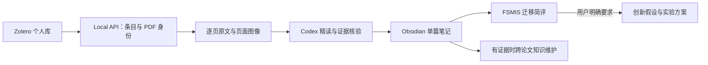

# FSMIS Research Workflow

一个以少样本医学图像分割（FSMIS）为研究核心的 **Zotero → Codex → Obsidian** 本地论文阅读工作流。也适用于医学图像分割、通用计算机视觉、综述和 Benchmark。

工具完成稳定入库、页面归档和受保护的笔记更新；Codex 负责理解原文、逐图解释、公式分析和实验评价。默认给每篇论文一段 FSMIS 迁移简评，只有明确要求时才深入设计创新方案。

> 版本：0.1.0。工具使用 Python 3.11+。依赖 Zotero 桌面端的 Local API；无需 Zotero Web API Key。分析在用户自己的 Codex 会话中执行，没有内置 OpenAI API 调用、后台任务或模型费用逻辑。

## 功能

- Zotero 父条目 Key 唯一识别论文，PDF Key 标识附件；重复入库复用已有笔记和全文。
- 原始 PDF 只读，逐页提取文本、渲染页面图片，记录 SHA-256 与物理页码。
- 一套通用精读模板，叠加 FSMIS / 医学图像分割 / 通用 CV / 综述与 Benchmark 模块。
- 自动分析区与人工区分开；更新前备份，检查并发修改与路径边界。
- 七个 Codex Skills，覆盖入库、阅读、检索、知识维护与明确触发的创新设计。
- 中文和含空格路径支持；安装程序默认拒绝覆盖不同内容。



## 快速开始

### 1. 安装依赖

先准备 Python 3.11+、Zotero、Obsidian 和可工作的 Codex。终端命令均在本仓库根目录执行。

macOS / Linux：

```sh
git clone https://github.com/mayByt/fsmis-research-workflow.git
cd fsmis-research-workflow
python3 -m venv .venv
source .venv/bin/activate
python -m pip install -r requirements.txt
```

Windows PowerShell：

```powershell
git clone https://github.com/mayByt/fsmis-research-workflow.git
cd fsmis-research-workflow
py -3.11 -m venv .venv
.\.venv\Scripts\Activate.ps1
python -m pip install -r requirements.txt
```

### 2. 初始化你选择的 Vault

```sh
python tools/install.py --vault "/absolute/path/to/ResearchVault"
```

Windows 示例路径可替换为 `"C:/Research/ResearchVault"`。在 Obsidian 使用“打开文件夹为仓库”打开同一个目录。

初始化会复制模板与七个 Skills，生成 `WORKFLOW.md`，在已有 `AGENTS.md` 末尾增加工作流入口。不会导入任何示例论文。原有文件内容不同时会停止；审查后可用 `--update-managed` 备份并替换本工具管理的文件。它不会批量更新已有论文笔记。

安装后的 Skill 及 `WORKFLOW.md` 会记录当前工作流根目录。移动或重命名本仓库后，应重新运行安装命令并审查更新。

### 3. 连接 Zotero

保持 Zotero 开启，在设置的 Advanced / 高级中允许本机其他应用与 Zotero 通信。然后：

```sh
python tools/workflow.py list
python tools/workflow.py list --query "paper title keyword"
python tools/workflow.py inspect ABCD1234
```

`ABCD1234` 是占位符，必须替换为自己库里实际返回的父条目 Key。多 PDF 附件时添加 `--pdf-key EFGH5678`。工具仅支持本机个人库，不支持群组库。

### 4. 入库与精读

```sh
python tools/workflow.py --vault "/absolute/path/to/ResearchVault" ingest ABCD1234
python tools/workflow.py --vault "/absolute/path/to/ResearchVault" validate
python tools/refresh_index.py --vault "/absolute/path/to/ResearchVault"
```

首次入库生成全文与笔记骨架，返回 `INGESTED_NOT_ANALYZED`；再次运行返回 `REUSED`。**入库成功不等于精读完成。**

在该 Vault 中打开 Codex，确认它读取 `AGENTS.md` 与 `WORKFLOW.md`，然后直接说：

- “阅读 Zotero 中《论文题名》，初筛核心贡献、主要方法和 FSMIS 迁移价值，并更新 Obsidian。”
- “精读 ABCD1234，重点解释 Figure 2、模块、关键公式和消融实验，迁移价值保持简评。”
- “检索已有笔记中有关原型建模的证据，并比较各论文的任务协议。”
- “基于这篇论文深入设计两种可检验的 FSMIS 创新方案。”

新 Skill 未显示时可重新打开该 Vault 的 Codex 会话。Skill 使用当前会话提供的文件/终端工具；本包不会替用户注册浏览器或第三方连接器。

## 配置

可以一直显式传 `--vault`。也可复制 `config.example.toml` 为不入 Git 的 `config.toml`：

```toml
[paths]
vault_root = "./ResearchVault"
zotero_data_dir = ""

[zotero]
api_url = "http://localhost:23119/api/users/0"
```

配置中的相对路径基于配置文件目录。`zotero_data_dir` 空值使用 `~/Zotero`；非默认位置请填写。环境变量 `RESEARCH_WORKFLOW_CONFIG` 指定配置文件，`RESEARCHVAULT_ROOT`、`ZOTERO_DATA_DIR`、`ZOTERO_LOCAL_API_URL` 覆盖对应配置。显式 `--vault` 优先。

API URL 限定为本机 HTTP 个人库路径。读取 Zotero 无需凭据，不直接修改 Zotero SQLite。

## 目录与数据约定

```text
ResearchVault/
├── AGENTS.md
├── WORKFLOW.md
├── .agents/skills/           # 七个技能
├── 00dashboard/             # 首页
├── 01knowledge/             # 经核验的跨论文知识
├── 02vault/<collection>/    # 一篇论文一份分析笔记
├── 03fulltext/<collection>/ # 原文；images/<key>/ 存页面图像
├── 04projects/ideas/        # 明确要求深入创新后生成
├── 模板/领域模块/
└── _staging/                # 元数据、锁、更新备份与安装清单
```

稳定字段为 `type: literature-note`、`zotero_key`、`pdf_key`、`note_path`、`fulltext_path`，路径相对 Vault。正式笔记 00–09 为自动区域，10 为人工区域。`study_area` 指任务/对象/场景，`core_variable` 指机制/概念/指标。完整字段和允许值见 [Schema](docs/SCHEMA.md)。

## Skills

| Skill | 职责 |
|---|---|
| research-vault-ingest-orchestrator | 单篇入库/精读总流程与验证 |
| zotero-data-fetcher | Local API、条目、附件与批注获取 |
| zotero-fulltext-archiver | 原文及页面图像归档与复用 |
| zotero-analytical-writer | 通用模板、领域路由、逐图/公式/实验分析 |
| research-vault-literature-retrieval | 先笔记定位，再查全文和原 PDF |
| research-vault-knowledge-maintainer | 有证据时定向维护跨论文知识 |
| fsmis-idea-lab | 仅明确请求时设计可验证创新方案 |

## 更新已有笔记

Writer 将第 00–09 节保存到 UTF-8 Markdown 文件（不含保护标记），将允许更新的分析字段放入 JSON，然后：

```sh
python tools/workflow.py --vault "/absolute/path/to/ResearchVault" update ABCD1234 \
  --body "/path/to/analysis.md" --metadata "/path/to/metadata.json"
```

工具只替换自动区域与允许字段，保留人工区，备份到 `_staging/backups/`。不会依据题名再创建第二份笔记。旧笔记无标记时应先审查迁移，勿直接整篇覆盖。

## 验证与当前限制

```sh
python -m unittest discover -s tests -v
python -m compileall -q tools tests
```

测试使用合成 PDF 和临时 Vault，不含真实论文或个人数据，覆盖入库/重复运行、原文变化、人工内容保护、路径与身份校验、安装冲突、配置与锁。CI 配置覆盖 Ubuntu、macOS、Windows；远程结果以 Actions 实际运行状态为准。

- 原型来自 FSMIS 工作流的本地实践，真实阅读已试用于 FSMIS 论文；其余领域模块尚未完成广泛真实语义评测。
- pypdf 不保证公式/表格顺序正确；扫描/低文本页面会停止，需要另行 OCR。PNG 为整页渲染，不是自动 Figure 分割。
- PDF/附件变化时停止覆盖；没有自动迁移、自动重解析或合并功能。异常退出留下锁时先确认没有运行中的进程，再处理 `_staging/locks/`。
- 按父 Key 保持单篇唯一性；多集合条目使用首个集合，尚不支持群组库。选择其他 PDF 附件需要显式审查身份迁移。
- 不内置 MinerU、向量数据库、模型服务、后台监听器或训练系统。知识维护尊重已有 Schema；本包未附带第三方固定 Knowledge Schema 的校验器。
- 本地文件写入采用备份和原子替换，并发编辑前会复核散列；不提供跨进程编辑器锁或整个 Vault 的事务保证。

## 开源范围与来源

MIT 许可证覆盖本仓库提供的代码、技能指令与模板。仓库不包含个人 Vault、论文 PDF/全文/页面图像、Zotero 数据库、真实阅读记录、账户凭据或本机配置。

整体分层和兼容字段受到 [Zotero-Analytical-Workflow-Skills](https://github.com/cheneternity/Zotero-Analytical-Workflow-Skills) 的启发。该上游仓库在准备本版本时未声明许可证，因此本包不分发其复制过来的 Skills、Knowledge 模板、Schema 或校验脚本；检索与知识维护能力在此包中重新编写。详见 [来源说明](docs/PROVENANCE.md)。

文献及第三方依赖保留各自的版权和许可证；本仓库的 MIT 不覆盖用户导入的论文或他人内容。
